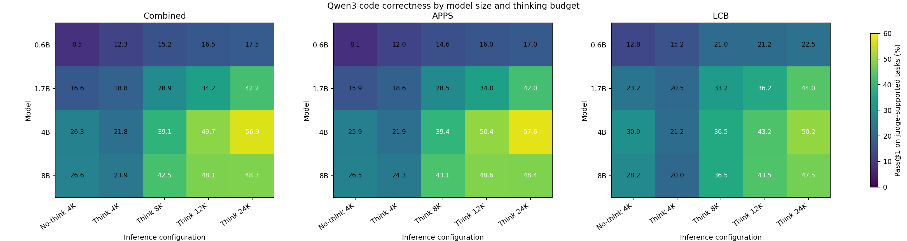
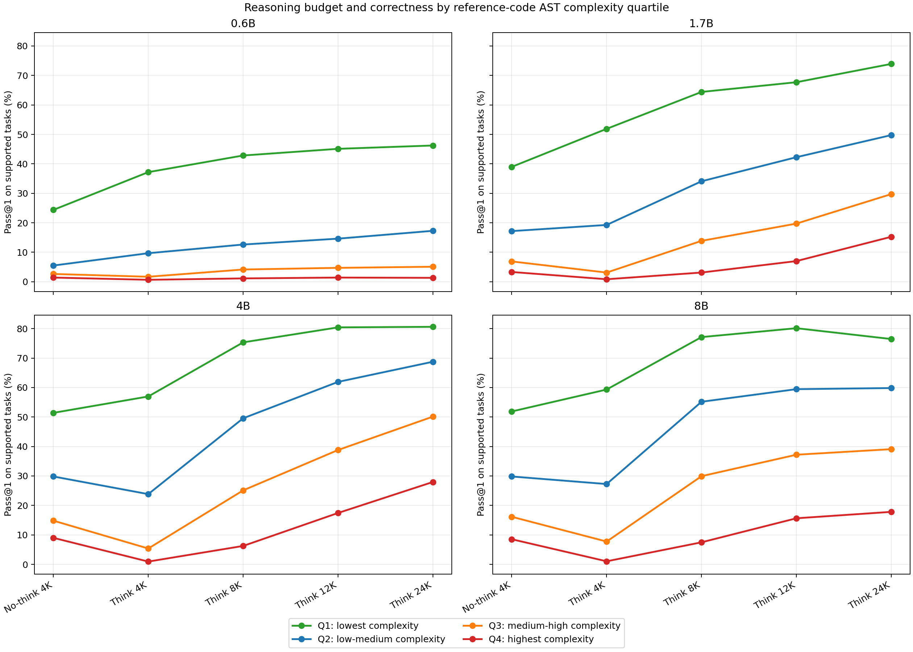
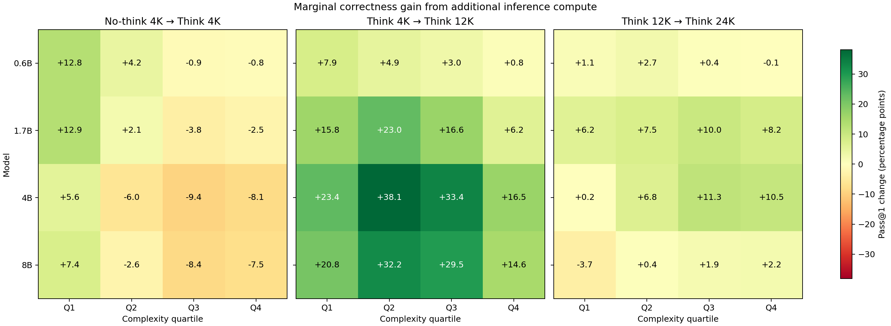

# Qwen3 Inference Scaling for Code Generation

This repository is an end-to-end study of how code-generation correctness
changes with **model size**, **reasoning budget**, and **problem complexity**.
It contains the complete pipeline from benchmark collection to vLLM serving,
correctness evaluation, and analysis.

The main experiment contains **86,540 generations** from four Qwen3 models
(0.6B, 1.7B, 4B, and 8B), five inference configurations, and 4,327 matched
APPS + LiveCodeBench tasks.

$$
P(\mathrm{correct}) =
f(\mathrm{model\ size},\ \mathrm{reasoning\ budget},\ \mathrm{problem\ complexity})
$$

## Results at a glance

<p align="center">
  
</p>

The best observed configuration is **Qwen3-4B / Think 24K**, with **56.9%
pass@1** on the 4,229 tasks supported by the current judge. Think 4K can be
worse than No-think 4K because a constrained reasoning trace may consume the
entire output budget before executable code is emitted.

<p align="center">
  
</p>

Additional reasoning helps most on intermediate-complexity tasks. Easy tasks
saturate earlier, while the hardest tasks need both model capacity and enough
inference budget.

<p align="center">
  
</p>

The largest marginal gain generally occurs between Think 4K and Think 12K;
returns diminish from 12K to 24K. See the [analysis overview](analysis/README.md)
and [master report](analysis/outputs/master_report.md) for the complete results,
limitations, and exact tables.

## Pipeline

The active repository is organized into six numbered conceptual stages:

| Stage | Directory | Responsibility | Main output |
|---|---|---|---|
| 1 | [`data_collection/`](data_collection/README.md) | Download, inspect, clean, and repair benchmark records; collect missing reference solutions | normalized benchmark JSONL |
| 2 | [`fair_data/`](fair_data/README.md) | Keep the task intersection with valid reference code and complexity traces | generation-ready fair JSONL |
| 3 | [`complexity_metrics/`](complexity_metrics/README.md) | Compute AST, Halstead, raw, maintainability, and cyclomatic metrics | task-level trace JSONL |
| 4 | [`generation/`](generation/README.md) | Configure Qwen3 models, serve them with vLLM, and generate solutions | generation JSONL and manifests |
| 5 | [`test_harness/`](test_harness/README.md) | Normalize model output and evaluate it in isolated subprocesses with a bounded process pool | correctness CSV |
| 6 | [`analysis/`](analysis/README.md) | Analyze serving behavior, pass@1, complexity interactions, and marginal gains | reports, tables, and plots |

```text
data_collection -> complexity_metrics -> fair_data -> generation
                                                     |
                                                     v
analysis        <- correctness CSV       <- test_harness
```

Superseded prototypes, old judges, abandoned experiment outputs, and previous
run layouts live in [`legacy/`](legacy/README.md). Nothing under `legacy/` is
part of the supported pipeline. See [`MIGRATION.md`](MIGRATION.md) for the exact
old-to-new path map.

## Quick start

Run commands from the repository root. Install the lightweight pipeline
dependencies with Python 3.10 or newer:

```bash
python3 -m venv .venv
source .venv/bin/activate
python -m pip install -r requirements.txt
```

vLLM is intentionally installed separately because the correct build depends
on the host CUDA/PyTorch stack. Place model snapshots under
`generation/models/`, then start a configured server:

```bash
python -m generation.vllm.launch_server \
  --config generation/configs/servers/qwen3-0.6b.yaml
```

In another shell, run an experiment:

```bash
python -m generation.vllm.generate \
  --model Qwen3-0.6B \
  --base-url http://127.0.0.1:8000 \
  --run-id my_run \
  --experiment generation/configs/experiments/scaling_law_001.yaml
```

The checked-in analysis targets the existing `scaling_law_001` layout. To
evaluate it and regenerate all reports:

```bash
test_harness/.venv/bin/python -m test_harness.harness \
  --workers 4 \
  --max-in-flight 8 \
  --output analysis/outputs/correctness_results.csv \
  --overwrite

python analysis/analyze_scaling.py
python analysis/analyze_correctness.py
python analysis/analyze_complexity_budget.py
```

Use `--limit 1` on the harness command for a quick smoke test. The judge has
its own dependency set in `test_harness/requirements.txt` so generated code is
not executed in the main project environment.

## Repository and artifact policy

Model weights, downloaded Hugging Face datasets, full normalized/fair JSONL,
and raw generation runs are deliberately excluded by `.gitignore`; together
they occupy tens of gigabytes. Code, YAML configs, compact subsets, repaired
reference solutions, correctness results, reports, and rendered figures remain
versionable. Therefore the plots above render normally on GitHub after the
repository is committed and pushed.
