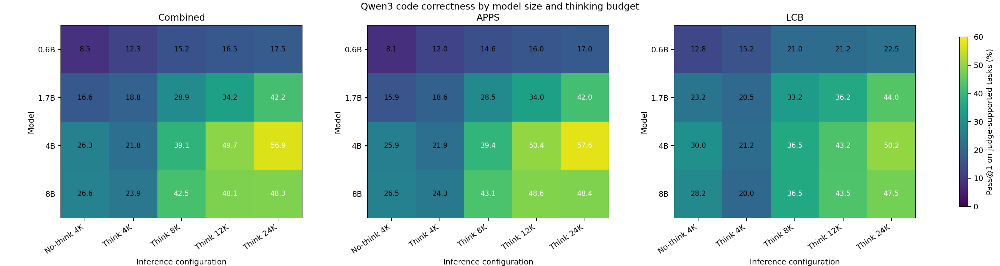
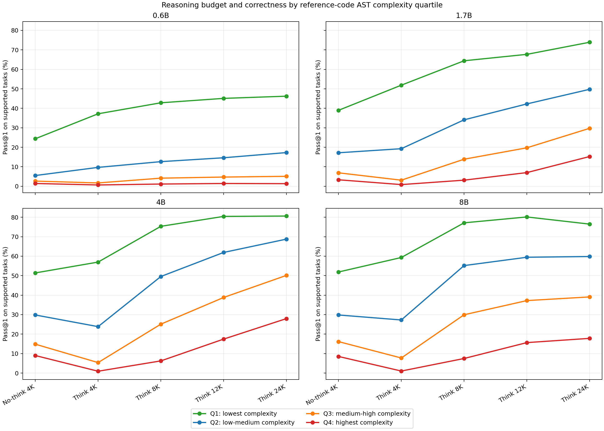
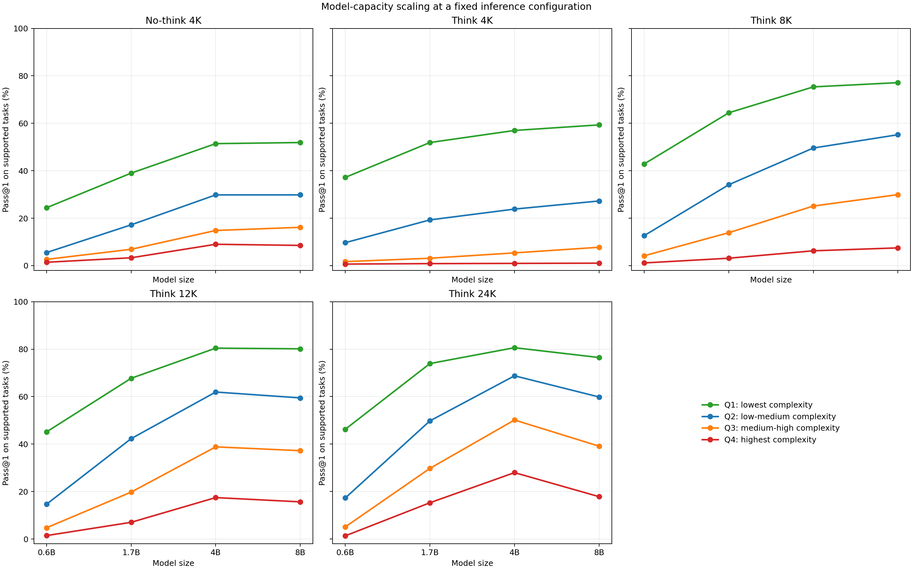
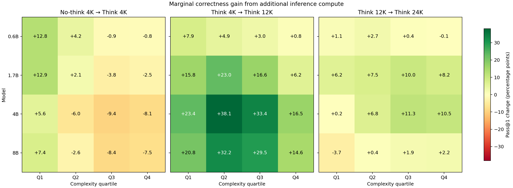
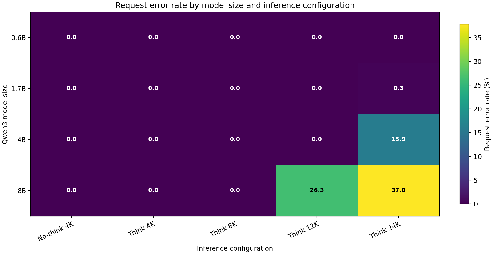

# Qwen3 Inference Scaling for Code Generation

This project studies how code-generation correctness changes with **model size**, **reasoning budget**, and **problem complexity**.

The controlled evaluation uses **86,540 generations** across:

- 4 Qwen3 model sizes: 0.6B, 1.7B, 4B, and 8B;
- 5 inference settings: No-think 4K and Think 4K, 8K, 12K, and 24K;
- 4,327 matched APPS and LiveCodeBench tasks.

The main question is:

$$
P(\mathrm{correct})
=
f(\mathrm{model\ size},\ \mathrm{reasoning\ budget},\ \mathrm{problem\ complexity})
$$

## Key findings

1. **Reasoning budget is a meaningful inference-time control.**

   Increasing the thinking budget substantially improves pass@1 for the 0.6B–4B models. For example, Qwen3-4B improves from **21.8% at Think 4K to 56.9% at Think 24K**.

2. **Too little reasoning budget can be worse than no thinking.**

   At a 4K cap, larger thinking models frequently exhaust the budget before producing executable code. This makes Think 4K worse than No-think 4K for the 4B and 8B models.

3. **Problem complexity changes where additional inference compute is useful.**

   Reference-code AST and cyclomatic complexity strongly stratify task difficulty. Extra reasoning produces its largest gains on intermediate-complexity tasks, while the hardest tasks often require both more model capacity and more inference budget.

4. **Model capacity and reasoning budget interact.**

   Larger models do not realize their full advantage under severely constrained reasoning budgets. Conversely, additional reasoning cannot fully compensate for insufficient model capacity on the hardest tasks.

5. **Serving reliability is part of end-to-end accuracy.**

   The high-budget 8B runs encountered substantial client-side one-hour read timeouts. As a result, the larger model had strong conditional solutions but did not outperform 4B end to end at 12K or 24K.

## Main results

### End-to-end correctness

<p align="center">
  
</p>

<p align="center">
  <em>Pass@1 across model size and inference configuration for the combined, APPS, and LiveCodeBench task sets.</em>
</p>

The best observed cell is **Qwen3-4B / Think 24K**, with **56.9% pass@1** on the 4,229 judge-supported tasks.

### Reasoning budget conditioned on problem complexity

<p align="center">
  
</p>

<p align="center">
  <em>Correctness versus reasoning budget, conditioned on reference-code AST complexity. Quartiles are fixed across every model and configuration.</em>
</p>

Correctness falls sharply with complexity in every cell. Additional reasoning helps most when tasks are difficult enough to benefit from it but still within the model's capacity.

### Model-capacity scaling at a fixed inference configuration

<p align="center">
  
</p>

<p align="center">
  <em>Model-capacity scaling while holding the inference configuration and complexity quartile fixed.</em>
</p>

Most useful capacity scaling occurs from 0.6B→1.7B and 1.7B→4B. The observed 4B→8B gain is small through Think 8K and becomes negative at 12K/24K because the high-budget 8B cells contain many failed requests.

### Marginal inference-compute gains

<p align="center">
  
</p>

<p align="center">
  <em>Pass@1 changes for No-think 4K→Think 4K, Think 4K→Think 12K, and Think 12K→Think 24K.</em>
</p>

Think 4K→Think 12K is the strongest transition for the larger models, reaching **+38.1 percentage points for 4B/Q2**. Returns diminish sharply from 12K→24K, particularly for simple tasks and the 8B model.

### High-budget serving reliability

<p align="center">
  
</p>

<p align="center">
  <em>Raw request-error rates. Recorded generation errors are ReadTimeout failures rather than successful short completions.</em>
</p>

The raw error rate reaches **26.35% for 8B/Think 12K** and **37.83% for 8B/Think 24K**. Token-length summaries exclude these failed requests because they have no usage record.

## Practical takeaway

The results suggest that reasoning budget should not be treated as a fixed global setting.

Easy problems often saturate early, medium-complexity problems benefit strongly from additional reasoning, and very hard problems may remain unsolved unless model capacity also increases.

In practice, the useful inference budget depends jointly on:

$$
(\mathrm{model\ capacity},\ \mathrm{task\ complexity},\ \mathrm{serving\ budget})
$$

Large reasoning budgets also introduce systems costs. The 8B high-budget runs suffered substantial one-hour read timeouts, showing that additional test-time compute can improve conditional solution quality while reducing end-to-end reliability.

The strongest observed operating points are:

- **4B / Think 12K** for simple tasks, where Q1 accuracy is already 80.4%;
- **4B / Think 24K** for maximum overall accuracy and continued gains on Q2–Q4;
- **No-think 4K** when a short output budget cannot accommodate both reasoning and a final program.

## Reports and exact results

- [Master report](outputs/master_report.md)
- [Generation and serving report](outputs/report.md)
- [Correctness report](outputs/correctness_report.md)
- [Complexity-conditioned report](outputs/complexity_correctness_report.md)
- [Correctness matrix](outputs/correctness_pass_rate_pct_matrix.csv)
- [Marginal capacity values](outputs/complexity_model_capacity_trends.csv)
- [Marginal inference-compute values](outputs/complexity_inference_compute_marginal_gains.csv)

## Reproduce the analysis

From the `Compression_Law` directory:

```bash
python3 analysis/analyze_scaling.py
python3 analysis/analyze_correctness.py
python3 analysis/analyze_complexity_budget.py
```

The first script analyzes generation behavior. The second consumes the correctness CSV produced by `test_harness/harness.py`. The third joins correctness with reference-solution complexity metrics and regenerates the complexity, capacity, and marginal-compute figures shown above.

## Interpretation boundary

- These are end-to-end pass@1 results from one generation per task/configuration, not pass@k.
- The current judge supports 4,229 of 4,327 tasks per cell; 98 APPS function-call-style tasks require a separate evaluator.
- Output comparison is exact after trimming leading/trailing whitespace, and each testcase has a two-second subprocess timeout.
- The high-budget 4B/8B comparisons are confounded by request timeouts and should not be interpreted as isolated model-capability measurements.
- Only four model sizes and four thinking budgets are available, so the observed relationships are descriptive rather than a fitted universal scaling law.
