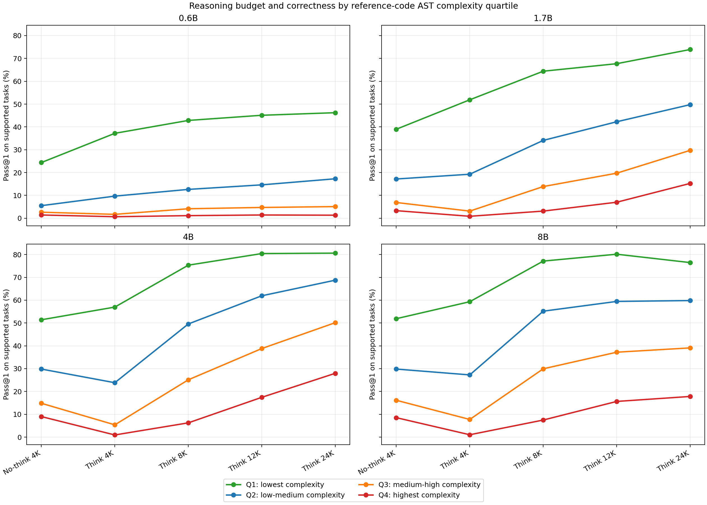
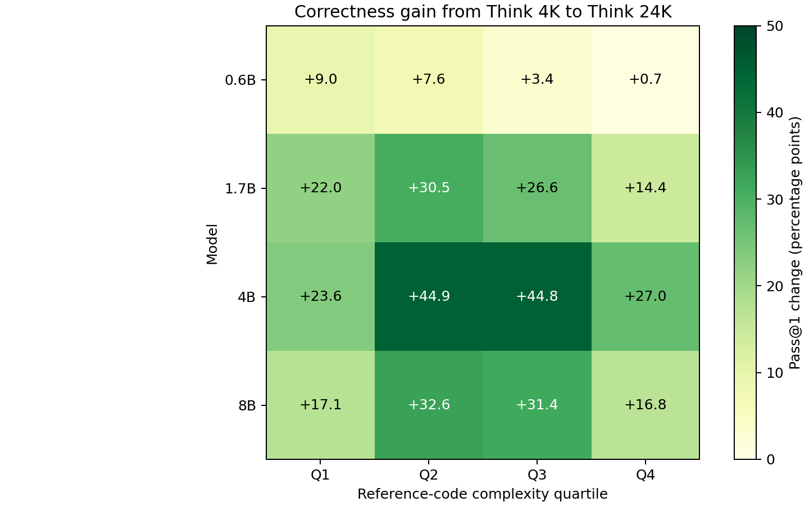
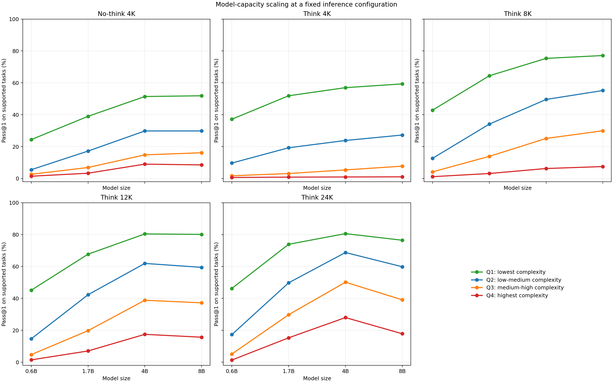
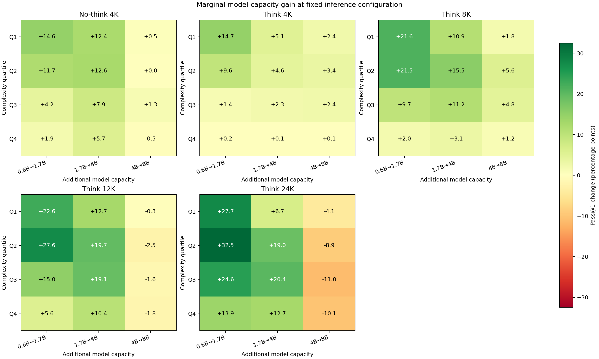
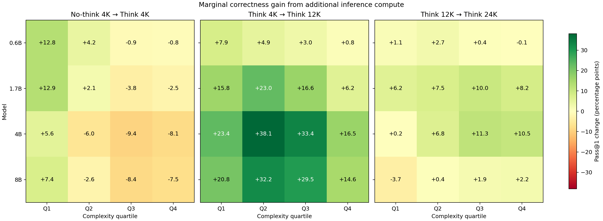
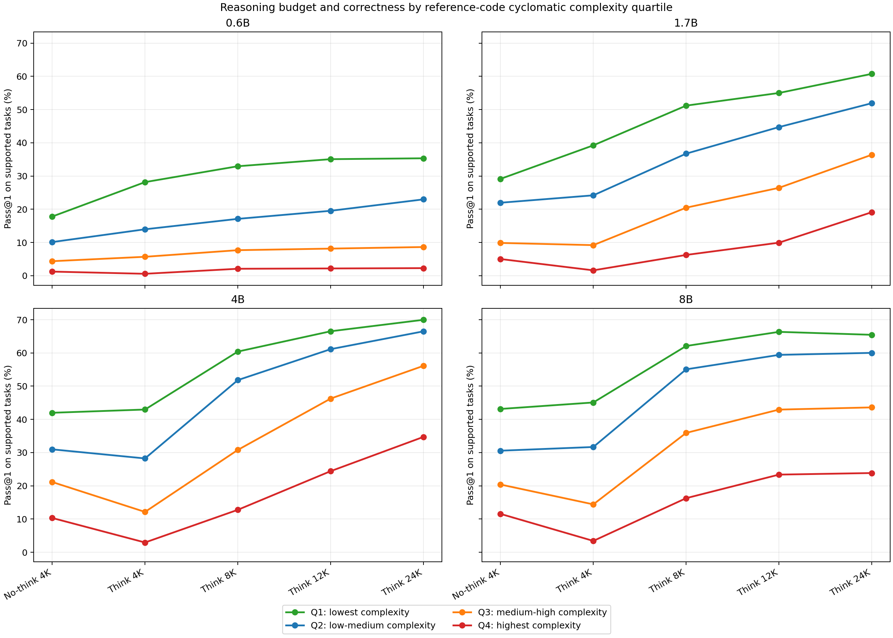

# Reasoning budget, code complexity, and correctness

## Method

Complexity is defined per benchmark task from its reference solutions, not from the generated answer. This avoids changing the complexity group across models or using properties of a failed answer to define task difficulty.

The primary proxy is `AST_Length`, averaged across available reference solutions. It measures structural code size and is strongly associated in this dataset with LOC (Spearman 0.94), Halstead effort (0.88), nesting depth (0.73), and cyclomatic complexity (0.66). Quartiles are formed once over the 4,229 judge-supported tasks.

| Quartile | Description | Tasks | Minimum | Median | Maximum |
|---|---|---:|---:|---:|---:|
| Q1 | lowest complexity | 1,062 | 14.1 | 57.5 | 79.0 |
| Q2 | low-medium complexity | 1,053 | 79.2 | 101.0 | 126.8 |
| Q3 | medium-high complexity | 1,059 | 126.8 | 160.7 | 207.0 |
| Q4 | highest complexity | 1,055 | 207.0 | 292.4 | 3212.6 |

## Main result

Correctness decreases sharply with reference-code complexity at every model size and budget. More reasoning budget usually improves every quartile, but it does not close the complexity gap. The largest absolute gains generally occur in the middle quartiles, where tasks are difficult enough to benefit from reasoning but not so hard that nearly all small-model attempts fail.

### 0.6B

| Quartile | Tasks | No-think | Think 4K | Think 8K | Think 12K | Think 24K | 24K − 4K | Best |
|---|---:|---:|---:|---:|---:|---:|---:|---:|
| Q1 | 1,062 | 24.4% | 37.2% | 42.8% | 45.1% | 46.2% | +9.0 pp | Think 24K |
| Q2 | 1,053 | 5.5% | 9.7% | 12.6% | 14.6% | 17.3% | +7.6 pp | Think 24K |
| Q3 | 1,059 | 2.6% | 1.7% | 4.2% | 4.7% | 5.1% | +3.4 pp | Think 24K |
| Q4 | 1,055 | 1.4% | 0.7% | 1.1% | 1.4% | 1.3% | +0.7 pp | Think 12K |

### 1.7B

| Quartile | Tasks | No-think | Think 4K | Think 8K | Think 12K | Think 24K | 24K − 4K | Best |
|---|---:|---:|---:|---:|---:|---:|---:|---:|
| Q1 | 1,062 | 39.0% | 51.9% | 64.4% | 67.7% | 73.9% | +22.0 pp | Think 24K |
| Q2 | 1,053 | 17.2% | 19.3% | 34.1% | 42.3% | 49.8% | +30.5 pp | Think 24K |
| Q3 | 1,059 | 6.9% | 3.1% | 13.9% | 19.7% | 29.7% | +26.6 pp | Think 24K |
| Q4 | 1,055 | 3.3% | 0.9% | 3.1% | 7.0% | 15.3% | +14.4 pp | Think 24K |

### 4B

| Quartile | Tasks | No-think | Think 4K | Think 8K | Think 12K | Think 24K | 24K − 4K | Best |
|---|---:|---:|---:|---:|---:|---:|---:|---:|
| Q1 | 1,062 | 51.4% | 57.0% | 75.3% | 80.4% | 80.6% | +23.6 pp | Think 24K |
| Q2 | 1,053 | 29.8% | 23.8% | 49.6% | 61.9% | 68.8% | +44.9 pp | Think 24K |
| Q3 | 1,059 | 14.8% | 5.4% | 25.1% | 38.8% | 50.1% | +44.8 pp | Think 24K |
| Q4 | 1,055 | 9.0% | 0.9% | 6.3% | 17.4% | 28.0% | +27.0 pp | Think 24K |

### 8B

| Quartile | Tasks | No-think | Think 4K | Think 8K | Think 12K | Think 24K | 24K − 4K | Best |
|---|---:|---:|---:|---:|---:|---:|---:|---:|
| Q1 | 1,062 | 51.9% | 59.3% | 77.1% | 80.1% | 76.5% | +17.1 pp | Think 12K |
| Q2 | 1,053 | 29.8% | 27.3% | 55.2% | 59.4% | 59.8% | +32.6 pp | Think 24K |
| Q3 | 1,059 | 16.1% | 7.7% | 29.9% | 37.2% | 39.1% | +31.4 pp | Think 24K |
| Q4 | 1,055 | 8.5% | 1.0% | 7.5% | 15.6% | 17.8% | +16.8 pp | Think 24K |

## What the interaction looks like

- **0.6B:** budget gains are concentrated in Q1–Q2. Q4 remains near 1%, so extra tokens cannot compensate for limited model capacity on the most structurally complex tasks.
- **1.7B:** all quartiles improve; Q2 and Q3 gain the most from 4K to 24K.
- **4B:** the strongest overall interaction. Think 24K reaches about 81% on Q1 and 28% on Q4, with roughly 45-point gains in Q2–Q3 versus Think 4K.
- **8B:** gains flatten at high budgets. Q1 peaks at Think 12K and then declines at 24K; high-budget generation failures prevent the larger model from dominating 4B end to end.

Across the 20 model/configuration cells, the task-level Spearman association between `AST_Length` and acceptance ranges from -0.543 to -0.313; it is negative in every cell.

## Fixed inference configuration: model-capacity returns

Each panel below fixes the inference configuration and compares model sizes within the same task-complexity quartile. This separates model-capacity scaling from inference-budget scaling.

The heatmaps show the marginal percentage-point change for each adjacent model-size step. The strongest improvements usually occur from 0.6B to 1.7B and from 1.7B to 4B. Moving from 4B to 8B has little benefit at low budgets and is negative at Think 12K/24K because the 8B high-budget runs have more incomplete or failed generations. At Think 24K, 4B to 8B changes Q1–Q4 by -4.1, -8.9, -11.0, -10.1 points respectively.

## Marginal inference-compute returns

The first transition changes decoding mode while holding the nominal 4K cap fixed; the next two increase the thinking budget. Green cells are gains and red cells are regressions in end-to-end pass@1.

Think 4K is often worse than no-think 4K for Q2–Q4 on the larger models. The largest gain from Think 4K to Think 12K is +38.1 points for 4B/Q2. Returns then diminish sharply from 12K to 24K: several cells are near zero, and 8B/Q1 changes by -3.7 points. Harder quartiles can still gain at 24K for 1.7B and 4B, but the benefit is not uniform.

## Cyclomatic-complexity sensitivity check

The table below repeats the Think 24K minus Think 4K comparison after redefining quartiles using cyclomatic complexity. The same qualitative conclusion remains: reasoning budget helps all complexity levels, with the strongest gains usually in the middle/high-but-not-extreme groups.

| Model | Q1 | Q2 | Q3 | Q4 |
|---|---:|---:|---:|---:|
| 0.6B | +7.2 pp | +9.0 pp | +2.9 pp | +1.7 pp |
| 1.7B | +21.5 pp | +27.7 pp | +27.2 pp | +17.5 pp |
| 4B | +27.0 pp | +38.3 pp | +44.0 pp | +31.8 pp |
| 8B | +20.4 pp | +28.3 pp | +29.2 pp | +20.4 pp |

## Interpretation limits

- Reference-solution complexity is a proxy for task complexity. It also reflects implementation style, choice of algorithm, and the number of reference solutions available.
- `AST_Length` primarily measures structural size, not conceptual or mathematical difficulty; the cyclomatic sensitivity check partly addresses this.
- Quartile results are descriptive. Each budget trend has only four aggregate points, so the reported budget correlations are not a fitted scaling law.
- The correctness values inherit the judge limitations in `correctness_report.md`: exact stripped-output comparison, a two-second timeout per testcase, and exclusion of 98 unsupported APPS tasks.
- APPS supplies most tasks. Dataset-specific rows are included in the CSV outputs, but the report emphasizes the combined controlled slice.
