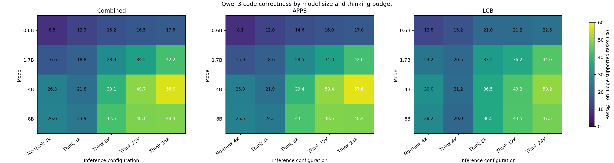
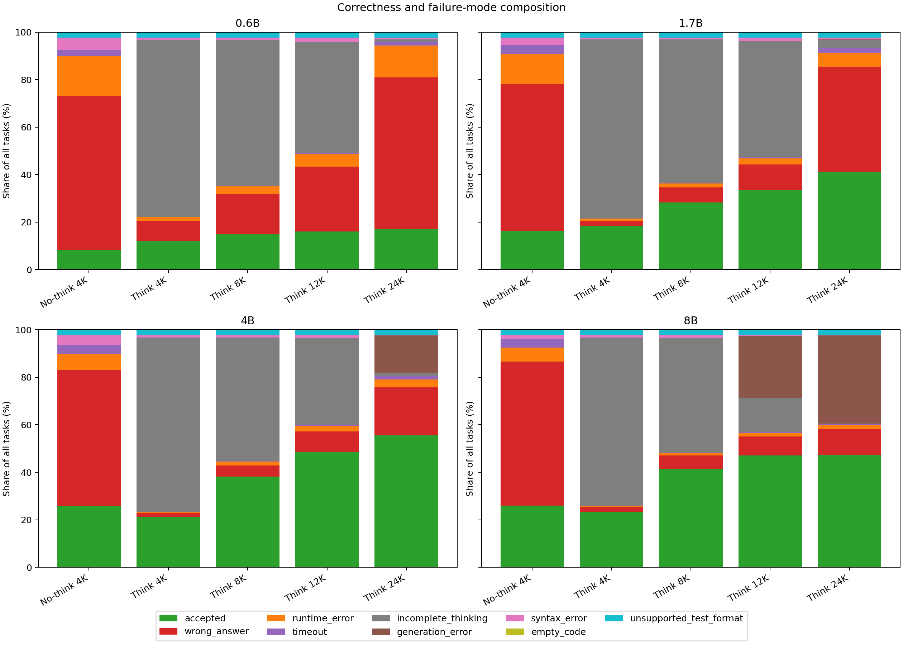
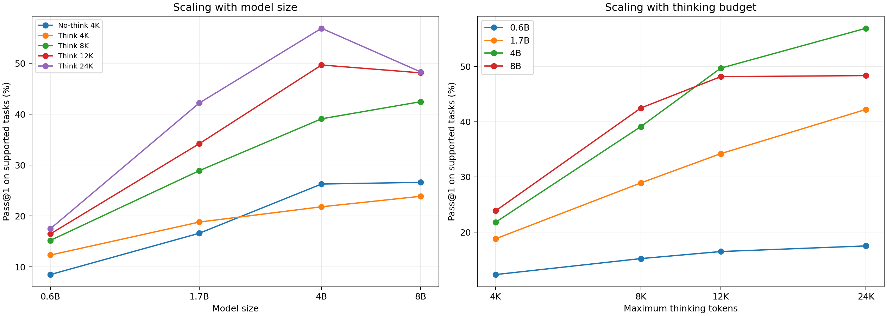

# Qwen3 correctness analysis

## Executive summary

The harness evaluated 86,540 generations from 4,327 tasks across 20 model/configuration cells. It accepted 25,127 generations: a strict all-task pass rate of 29.04% and a judge-supported pass rate of 29.71%.

The best cell is **4B / Think 24K** at **56.89%** (2,406/4,229 supported tasks).

The central pattern is not a simple `larger model = better` law. More thinking budget strongly helps through 4B, but 8B stops improving after 12K and falls behind 4B at 12K and 24K because high-budget generation failures offset its stronger conditional solutions.

## Coverage and denominators

- Strict denominator: all 86,540 rows.
- Judge-supported denominator: 84,580 rows (97.74% coverage).
- Unsupported coverage: 98 APPS tasks use non-string/function-call-style cases; this creates 1,960 unsupported rows, exactly the same tasks in every cell.
- Executed denominator: 51,013 rows reached a test subprocess. Conditional pass rate among those rows is 49.26%, but this is selection-biased and is not the primary score.

Because unsupported tasks are identical across all cells, excluding them preserves matched comparisons. The primary tables below therefore use judge-supported pass@1.

## Combined pass@1 matrix

| Model | No-think 4K | Think 4K | Think 8K | Think 12K | Think 24K |
|---|---:|---:|---:|---:|---:|
| 0.6B | 8.51% | 12.34% | 15.23% | 16.51% | 17.52% |
| 1.7B | 16.62% | 18.82% | 28.92% | 34.22% | 42.21% |
| 4B | 26.29% | 21.83% | 39.11% | 49.68% | 56.89% |
| 8B | 26.63% | 23.88% | 42.47% | 48.14% | 48.33% |

## Dataset-specific matrices

### APPS

| Model | No-think 4K | Think 4K | Think 8K | Think 12K | Think 24K |
|---|---:|---:|---:|---:|---:|
| 0.6B | 8.07% | 12.04% | 14.63% | 16.01% | 17.00% |
| 1.7B | 15.93% | 18.65% | 28.47% | 34.00% | 42.02% |
| 4B | 25.91% | 21.89% | 39.38% | 50.35% | 57.59% |
| 8B | 26.46% | 24.29% | 43.09% | 48.63% | 48.42% |

### LCB

| Model | No-think 4K | Think 4K | Think 8K | Think 12K | Think 24K |
|---|---:|---:|---:|---:|---:|
| 0.6B | 12.75% | 15.25% | 21.00% | 21.25% | 22.50% |
| 1.7B | 23.25% | 20.50% | 33.25% | 36.25% | 44.00% |
| 4B | 30.00% | 21.25% | 36.50% | 43.25% | 50.25% |
| 8B | 28.25% | 20.00% | 36.50% | 43.50% | 47.50% |

## Thinking versus no-thinking at the same 4K cap

This is a paired comparison on the same supported tasks. `Only pass` counts tasks solved by one configuration but not the other.

| Model | No-think pass | Think 4K pass | Delta | No-think only | Think only | Both pass |
|---|---:|---:|---:|---:|---:|---:|
| 0.6B | 8.51% | 12.34% | +3.83 pp | 131 | 293 | 229 |
| 1.7B | 16.62% | 18.82% | +2.20 pp | 230 | 323 | 473 |
| 4B | 26.29% | 21.83% | -4.47 pp | 475 | 286 | 637 |
| 8B | 26.63% | 23.88% | -2.74 pp | 455 | 339 | 671 |

Think 4K helps the 0.6B and 1.7B models, but hurts the 4B and 8B models. The 4K thinking cap frequently ends before `</think>`, so extra reasoning is useful only when enough of it reaches executable code.

## Failure composition

| Status | Rows | Share of all rows |
|---|---:|---:|
| `accepted` | 25,127 | 29.04% |
| `wrong_answer` | 21,027 | 24.30% |
| `runtime_error` | 3,857 | 4.46% |
| `timeout` | 1,002 | 1.16% |
| `incomplete_thinking` | 28,861 | 33.35% |
| `generation_error` | 3,436 | 3.97% |
| `syntax_error` | 1,265 | 1.46% |
| `empty_code` | 5 | 0.01% |
| `unsupported_test_format` | 1,960 | 2.26% |

`incomplete_thinking`, `generation_error`, `syntax_error`, and `empty_code` fail before tests can establish semantic correctness. This is why end-to-end pass@1 is lower than correctness conditional on executable outputs.

## Scaling relationships

### Thinking-budget trends

| Model | 4K | 8K | 12K | 24K | r vs log2 budget | Monotonic | Best |
|---|---:|---:|---:|---:|---:|:---:|---:|
| 0.6B | 12.34% | 15.23% | 16.51% | 17.52% | 0.970 | yes | Think 24K |
| 1.7B | 18.82% | 28.92% | 34.22% | 42.21% | 0.998 | yes | Think 24K |
| 4B | 21.83% | 39.11% | 49.68% | 56.89% | 0.978 | yes | Think 24K |
| 8B | 23.88% | 42.47% | 48.14% | 48.33% | 0.888 | yes | Think 24K |

### Model-size trends

| Configuration | 0.6B | 1.7B | 4B | 8B | r vs log2 size | Monotonic | Best model |
|---|---:|---:|---:|---:|---:|:---:|---:|
| No-think 4K | 8.51% | 16.62% | 26.29% | 26.63% | 0.971 | yes | 8B |
| Think 4K | 12.34% | 18.82% | 21.83% | 23.88% | 0.984 | yes | 8B |
| Think 8K | 15.23% | 28.92% | 39.11% | 42.47% | 0.987 | yes | 8B |
| Think 12K | 16.51% | 34.22% | 49.68% | 48.14% | 0.953 | no | 4B |
| Think 24K | 17.52% | 42.21% | 56.89% | 48.33% | 0.865 | no | 4B |

These correlations contain only four aggregate points each. They describe the observed matrix; they are not evidence of a universal scaling law.

## Interpretation limits

- This is one generated answer per task/configuration, so the score is pass@1 rather than pass@k.
- Output comparison is exact after trimming leading/trailing whitespace. It does not implement token-wise whitespace equivalence, special judges, or floating-point tolerance, so these are harness-defined correctness rates rather than official APPS/LCB leaderboard scores.
- Each testcase has a two-second subprocess timeout. Programs exceeding it are counted as incorrect.
- The 98 unsupported APPS tasks need a separate function-call evaluator before strict full-dataset accuracy can be claimed.
- Conditional accuracy among executed programs excludes generation and normalization failures and should not replace end-to-end pass@1.
