# Master report: Qwen3 inference scaling, serving reliability, and code correctness

Analysis snapshot: 2026-09-30  
Source run: `generation/runs/vllm/scaling_law_001`  
Models: Qwen3-0.6B, Qwen3-1.7B, Qwen3-4B, and Qwen3-8B  
Controlled datasets: APPS and LiveCodeBench (LCB)

## Executive summary

This project evaluates how Qwen3 model size and inference-time reasoning budget interact on competitive-programming generation. It connects three layers that should not be interpreted separately:

1. **Generation and serving behavior:** how long the responses are, whether thinking reaches a final answer, and whether the request completes successfully.
2. **End-to-end code correctness:** whether the generated program survives normalization and passes the available stdin/stdout tests.
3. **Task complexity:** whether model capacity or additional inference compute helps equally on structurally simple and complex tasks.

The controlled matrix contains 4 models × 5 inference configurations × 4,327 tasks, for **86,540 generations**. The current judge supports 4,229 tasks per cell, yielding **84,580 judge-supported rows**.

The main conclusions are:

- **The best observed configuration is 4B / Think 24K**, with a judge-supported pass@1 of **56.89%** (2,406/4,229).
- **Increasing inference budget helps strongly through 4B**, but the gain is conditional on the request finishing and the model exiting its thinking block.
- **Think 4K is often too short.** It improves overall pass@1 for 0.6B and 1.7B, but reduces it for 4B and 8B because many responses end before `</think>` and never expose executable code.
- **The 8B model does not dominate 4B at high budgets.** At Think 12K and Think 24K, raw request-error rates reach **26.35%** and **37.83%** for 8B. These failures erase the larger model's potential quality advantage in end-to-end pass@1.
- **Task complexity is a strong negative predictor of correctness.** Across all 20 model/configuration cells, the Spearman association between reference-code `AST_Length` and acceptance ranges from **-0.543 to -0.313**.
- **Capacity and compute have diminishing returns.** The largest capacity gains usually occur from 0.6B→1.7B and 1.7B→4B. The 4B→8B transition is small at low budgets and negative in every complexity quartile at Think 12K and Think 24K under the observed serving conditions.
- **The largest requested compute step is Think 4K→Think 12K.** It adds as much as **+38.1 percentage points** for 4B/Q2. Think 12K→Think 24K has much smaller returns and is negative for 8B/Q1.
- **This is an end-to-end inference study, not a universal scaling law.** It has one generation per task/configuration, only four model sizes, and serving failures that confound the high-budget 4B/8B cells.

The most defensible project-level result is therefore a **capacity–budget–complexity–reliability frontier**: additional parameters and reasoning tokens improve code correctness only while the generation pipeline remains reliable enough to produce an executable final answer.

## 1. Questions addressed

The analysis answers four related questions.

### 1.1 What happens to generation behavior as model size and token budget increase?

This includes completion length, normal stops, final-answer availability, and request errors. These metrics describe the serving output but do not establish program correctness.

### 1.2 Do larger models and larger thinking budgets produce more correct code?

This is measured by end-to-end pass@1 on the supported benchmark tests. Normalization failures, unfinished thinking, request errors, runtime failures, and wrong answers all count against pass@1.

### 1.3 At a fixed inference configuration, how much does extra model capacity help each complexity regime?

Tasks are divided into fixed quartiles using the structural complexity of their reference solutions. Models are then compared on the same tasks within each quartile.

### 1.4 Where does additional inference compute stop paying off?

The requested comparisons are:

- No-think 4K → Think 4K;
- Think 4K → Think 12K;
- Think 12K → Think 24K.

The first transition changes reasoning mode while keeping the same nominal 4K output cap. The latter two increase the maximum thinking budget. They should therefore be read as practical inference-policy transitions, not three identical increments of compute.

## 2. Experimental design

### 2.1 Controlled model/configuration matrix

Every cell contains the same 4,327 task IDs.

| Model | No-think 4K | Think 4K | Think 8K | Think 12K | Think 24K |
|---|:---:|:---:|:---:|:---:|:---:|
| Qwen3-0.6B | yes | yes | yes | yes | yes |
| Qwen3-1.7B | yes | yes | yes | yes | yes |
| Qwen3-4B | yes | yes | yes | yes | yes |
| Qwen3-8B | yes | yes | yes | yes | yes |

The configuration directories are:

| Report label | Directory | Thinking enabled | Maximum tokens |
|---|---|:---:|---:|
| No-think 4K | `no_thinking_sampled_4k` | no | 4,096 |
| Think 4K | `thinking_4k_presence_1_0` | yes | 4,096 |
| Think 8K | `thinking_8k_presence_1_0` | yes | 8,192 |
| Think 12K | `thinking_12k_presence_1_0` | yes | 12,000 |
| Think 24K | `thinking_24k_presence_1_0` | yes | 24,000 |

### 2.2 Dataset coverage and denominators

| Dataset | Generated tasks per cell | Judge-supported tasks per cell | Unsupported tasks per cell |
|---|---:|---:|---:|
| APPS | 3,927 | 3,829 | 98 |
| LCB | 400 | 400 | 0 |
| **Combined** | **4,327** | **4,229** | **98** |

Across all 20 cells:

- generated rows: **86,540**;
- judge-supported rows: **84,580**;
- unsupported rows: **1,960**;
- rows reaching a test subprocess: **51,013**;
- accepted rows: **25,127**.

This gives:

- strict all-row pass rate: **29.04%**;
- judge-supported pass rate: **29.71%**;
- conditional pass rate among executed rows: **49.26%**.

The conditional executed-program rate is selection-biased: it removes request errors, incomplete thinking, syntax failures, and other cases where no program can be tested. It is diagnostic, not the primary score.

### 2.3 Generation-to-judgment pipeline

The evaluation pipeline is:

1. Stream the APPS or LCB benchmark JSONL one row at a time.
2. Stream the 20 corresponding generation files in lockstep.
3. Assert exact task-ID alignment between every benchmark and generation row.
4. Normalize each generated response:
   - classify request errors;
   - for thinking configurations, require a closing `</think>` tag;
   - prefer a valid Python Markdown fence when one is present;
   - otherwise use the remaining plain text;
   - parse the extracted code with Python's AST parser.
5. Normalize tests into `(stdin, expected_stdout)` pairs.
6. Write the program to an isolated temporary `solution.py`.
7. Run each testcase using `test_harness/.venv/bin/python` with a two-second timeout per testcase.
8. Stop on the first failure and record compact diagnostics.
9. Evaluate task jobs through a bounded rolling `ProcessPoolExecutor` queue and stream results to CSV.

One worker receives one benchmark task and evaluates all 20 model/configuration programs for that task. The multiprocessing is judge concurrency; it is not a measurement of vLLM request concurrency or serving throughput.

### 2.4 Status definitions

| Status | Meaning |
|---|---|
| `accepted` | Every available testcase passed. |
| `wrong_answer` | Program exited successfully but stripped stdout differed from stripped expected output. |
| `runtime_error` | Program returned a nonzero exit code. |
| `timeout` | One testcase exceeded two seconds. |
| `incomplete_thinking` | Thinking output did not contain a closing `</think>` tag, so no final program was exposed. |
| `generation_error` | The raw request had `finish_reason == "error"` or an error field. |
| `syntax_error` | Extracted code failed `ast.parse`. |
| `empty_code` | Extraction produced no program. |
| `unsupported_test_format` | Tests were not representable as string stdin/stdout pairs. |
| `worker_error` | Unexpected exception in a judge worker; none occurred in this completed run. |

### 2.5 Primary metric

The primary correctness metric is:

```text
supported pass@1 = accepted generations / judge-supported generations
```

All reported marginal gains are **absolute percentage-point differences**. For example, `+20` means pass@1 increased from, say, 40% to 60%; it does not mean a 20% relative increase.

## 3. Generation and serving behavior

These results come directly from the generation artifacts. They describe response production, not semantic correctness.

### 3.1 Completion length

#### Mean completion tokens

| Model | No-think 4K | Think 4K | Think 8K | Think 12K | Think 24K |
|---|---:|---:|---:|---:|---:|
| 0.6B | 435.5 | 3,605.3 | 6,487.0 | 8,679.6 | 10,710.9 |
| 1.7B | 434.7 | 3,665.9 | 6,550.1 | 8,719.2 | 11,821.7 |
| 4B | 450.6 | 3,645.8 | 6,267.1 | 8,006.5 | 8,564.4 |
| 8B | 330.4 | 3,611.7 | 6,133.1 | 6,469.5 | 6,104.4 |

#### Median completion tokens

| Model | No-think 4K | Think 4K | Think 8K | Think 12K | Think 24K |
|---|---:|---:|---:|---:|---:|
| 0.6B | 215 | 4,096 | 8,192 | 11,916 | 11,834 |
| 1.7B | 259 | 4,096 | 8,192 | 12,000 | 12,483 |
| 4B | 238 | 4,096 | 8,192 | 8,968 | 7,239.5 |
| 8B | 207 | 4,096 | 8,192 | 5,889 | 5,015 |

The 4K and 8K thinking medians sit exactly at the cap, showing that at least half of those generations exhaust the output budget. The shorter observed mean/median at high budgets for 8B must not be interpreted as efficient early stopping: request-error rows have no token usage and are excluded from token averages.

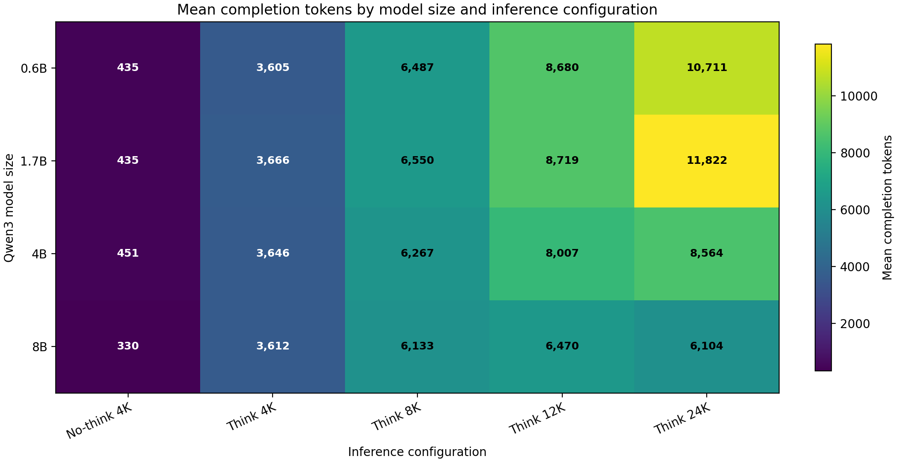

### 3.2 Normal-stop and final-answer rates

#### Normal-stop rate

| Model | No-think 4K | Think 4K | Think 8K | Think 12K | Think 24K |
|---|---:|---:|---:|---:|---:|
| 0.6B | 95.29% | 23.02% | 36.31% | 50.45% | 98.78% |
| 1.7B | 97.00% | 22.07% | 37.16% | 48.42% | 95.59% |
| 4B | 96.16% | 24.06% | 45.83% | 61.66% | 82.51% |
| 8B | 98.64% | 26.23% | 49.66% | 58.59% | 62.01% |

#### Final-answer rate

| Model | No-think 4K | Think 4K | Think 8K | Think 12K | Think 24K |
|---|---:|---:|---:|---:|---:|
| 0.6B | 100.00% | 24.24% | 37.60% | 52.65% | 99.12% |
| 1.7B | 100.00% | 22.90% | 38.57% | 50.22% | 96.51% |
| 4B | 100.00% | 25.12% | 47.08% | 63.16% | 82.71% |
| 8B | 100.00% | 27.62% | 51.14% | 59.12% | 62.05% |

For thinking configurations, a final answer requires a closed `</think>` block followed by non-empty content. For the no-thinking baseline, it means a non-empty response. The low Think 4K final-answer rates explain why a configuration can have high conditional correctness among executable programs but weak end-to-end pass@1.

### 3.3 Request reliability

| Model | No-think 4K | Think 4K | Think 8K | Think 12K | Think 24K |
|---|---:|---:|---:|---:|---:|
| 0.6B | 0.00% | 0.00% | 0.00% | 0.00% | 0.00% |
| 1.7B | 0.00% | 0.00% | 0.00% | 0.00% | 0.35% |
| 4B | 0.00% | 0.00% | 0.00% | 0.00% | 15.92% |
| 8B | 0.00% | 0.00% | 0.00% | 26.35% | 37.83% |

The raw artifacts contain **3,481 request errors**, all recorded as `ReadTimeout`:

| Cell | Raw timeout rows |
|---|---:|
| 1.7B / Think 24K | 15 |
| 4B / Think 24K | 689 |
| 8B / Think 12K | 1,140 |
| 8B / Think 24K | 1,637 |

The correctness results contain 3,436 `generation_error` rows rather than 3,481 because 45 raw timeout rows belong to the 98 unsupported APPS tasks. `evaluate_job` classifies those jobs as `unsupported_test_format` before inspecting individual program outputs. The raw generation count is the correct source for transport/request reliability; the supported-row status count is the correct source for the pass@1 failure decomposition.

These failures are **not recorded as “budget exceeded.”** The observable client error is `ReadTimeout`. A long budget may contribute to requests taking longer, but the artifacts do not establish a lower-level server cause.

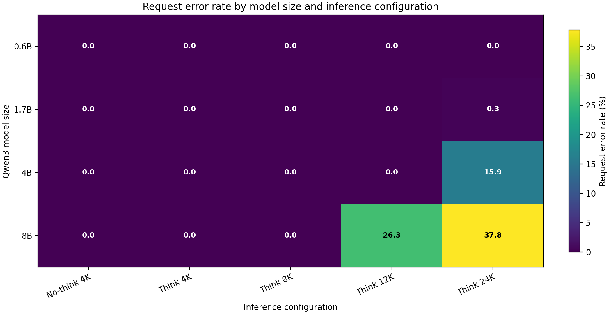

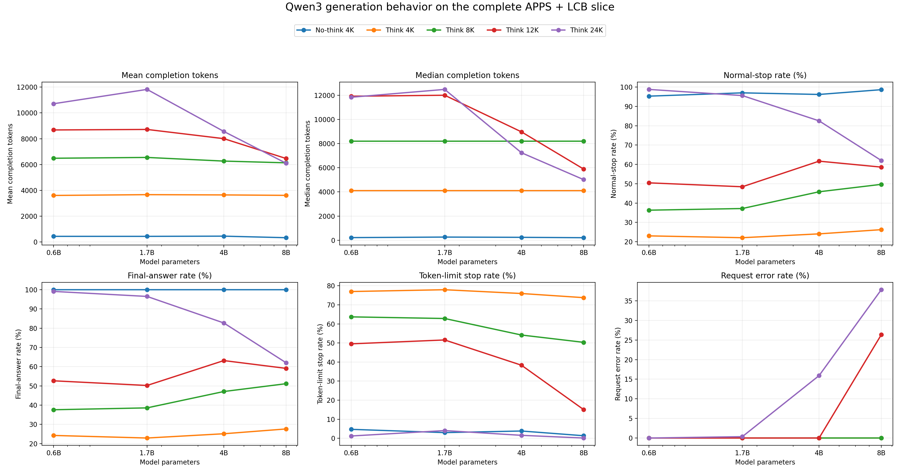

### 3.4 Serving interpretation

- Up to Think 8K, there are no recorded request errors in any model cell.
- Increasing budget generally increases the probability that a thinking response exits its thinking block, but the benefit is not free: longer requests expose reliability limits.
- The 4B model reaches the strongest end-to-end result despite a 15.92% Think 24K error rate, indicating that its successfully completed high-budget responses are strong enough to overcome substantial serving loss.
- The 8B model's apparent token shortening at 12K/24K is partly survivorship bias because failed requests contribute no token count.
- This dataset has no latency, requests-per-second, queueing-delay, GPU-utilization, or concurrency-sweep measurements. It supports a reliability analysis of vLLM-produced generations, not a throughput benchmark.

## 4. End-to-end code correctness

### 4.1 Combined pass@1

| Model | No-think 4K | Think 4K | Think 8K | Think 12K | Think 24K |
|---|---:|---:|---:|---:|---:|
| 0.6B | 8.51% | 12.34% | 15.23% | 16.51% | 17.52% |
| 1.7B | 16.62% | 18.82% | 28.92% | 34.22% | 42.21% |
| 4B | 26.29% | 21.83% | 39.11% | 49.68% | **56.89%** |
| 8B | 26.63% | 23.88% | 42.47% | 48.14% | 48.33% |

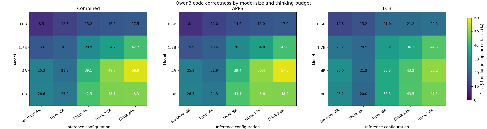

Several patterns are visible:

- Model scaling is monotonic through Think 8K.
- At Think 12K and Think 24K, 4B outperforms 8B end to end.
- The 0.6B model improves only modestly with large budgets because model capacity, rather than output budget alone, becomes the limiting factor.
- Think 4K is worse than no-think 4K for 4B and 8B.

### 4.2 Dataset-specific pass@1

#### APPS

| Model | No-think 4K | Think 4K | Think 8K | Think 12K | Think 24K |
|---|---:|---:|---:|---:|---:|
| 0.6B | 8.07% | 12.04% | 14.63% | 16.01% | 17.00% |
| 1.7B | 15.93% | 18.65% | 28.47% | 34.00% | 42.02% |
| 4B | 25.91% | 21.89% | 39.38% | 50.35% | 57.59% |
| 8B | 26.46% | 24.29% | 43.09% | 48.63% | 48.42% |

#### LCB

| Model | No-think 4K | Think 4K | Think 8K | Think 12K | Think 24K |
|---|---:|---:|---:|---:|---:|
| 0.6B | 12.75% | 15.25% | 21.00% | 21.25% | 22.50% |
| 1.7B | 23.25% | 20.50% | 33.25% | 36.25% | 44.00% |
| 4B | 30.00% | 21.25% | 36.50% | 43.25% | 50.25% |
| 8B | 28.25% | 20.00% | 36.50% | 43.50% | 47.50% |

The datasets show the same broad interaction even though LCB has only 400 tasks per cell. APPS dominates the combined estimate because it supplies 3,829 of the 4,229 supported tasks.

### 4.3 No-thinking versus thinking at the same 4K cap

This is a paired comparison over the same 4,229 supported tasks for each model.

| Model | No-think pass | Think 4K pass | Delta | No-think only | Think only | Both pass |
|---|---:|---:|---:|---:|---:|---:|
| 0.6B | 8.51% | 12.34% | +3.83 pp | 131 | 293 | 229 |
| 1.7B | 16.62% | 18.82% | +2.20 pp | 230 | 323 | 473 |
| 4B | 26.29% | 21.83% | -4.47 pp | 475 | 286 | 637 |
| 8B | 26.63% | 23.88% | -2.74 pp | 455 | 339 | 671 |

Thinking is therefore not automatically beneficial. At a 4K cap, the larger models often spend the available output budget reasoning and fail to emit a final program. The paired-only counts also show that the two modes solve different subsets of tasks; the aggregate delta is not simply a uniform improvement or regression.

### 4.4 Failure composition

| Status | Rows | Share of all 86,540 rows |
|---|---:|---:|
| `accepted` | 25,127 | 29.04% |
| `wrong_answer` | 21,027 | 24.30% |
| `runtime_error` | 3,857 | 4.46% |
| `timeout` | 1,002 | 1.16% |
| `incomplete_thinking` | 28,861 | 33.35% |
| `generation_error` | 3,436 | 3.97% |
| `syntax_error` | 1,265 | 1.46% |
| `empty_code` | 5 | 0.01% |
| `unsupported_test_format` | 1,960 | 2.26% |

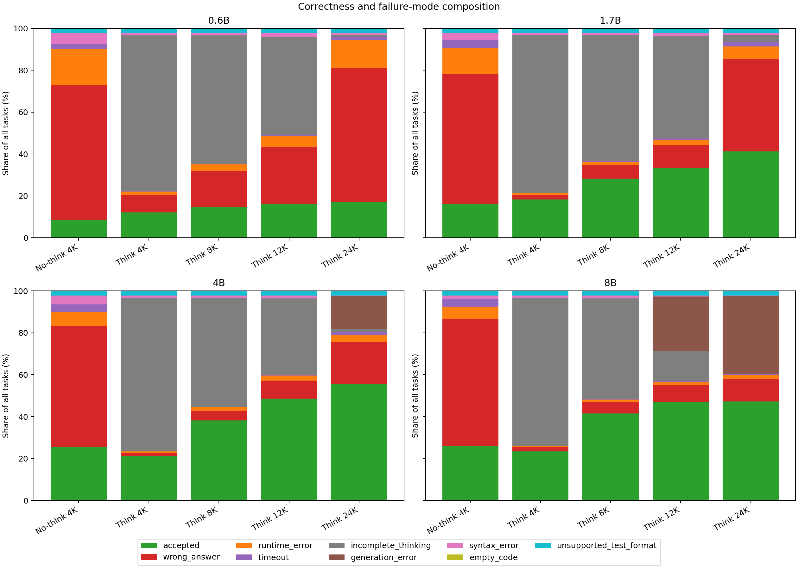

The largest single failure class is `incomplete_thinking`. This is a pipeline-level failure: the model may have produced useful reasoning, but no executable final answer is available. The second-largest failure class is semantic `wrong_answer`, which means the program ran but disagreed with at least one expected output.

### 4.5 Execution rate versus conditional correctness

The following table separates the probability of reaching the judge from correctness after reaching it.

| Model | Configuration | End-to-end pass@1 | Reached subprocess | Pass among executed | Incomplete thinking | Generation errors |
|---|---|---:|---:|---:|---:|---:|
| 0.6B | No-think 4K | 8.51% | 94.73% | 8.99% | 0 | 0 |
| 0.6B | Think 4K | 12.34% | 22.82% | 54.09% | 3,217 | 0 |
| 0.6B | Think 8K | 15.23% | 36.25% | 42.01% | 2,647 | 0 |
| 0.6B | Think 12K | 16.51% | 50.44% | 32.72% | 2,015 | 0 |
| 0.6B | Think 24K | 17.52% | 98.25% | 17.83% | 37 | 0 |
| 1.7B | No-think 4K | 16.62% | 96.76% | 17.18% | 0 | 0 |
| 1.7B | Think 4K | 18.82% | 22.01% | 85.50% | 3,265 | 0 |
| 1.7B | Think 8K | 28.92% | 37.38% | 77.36% | 2,610 | 0 |
| 1.7B | Think 12K | 34.22% | 48.55% | 70.48% | 2,114 | 0 |
| 1.7B | Think 24K | 42.21% | 95.65% | 44.13% | 136 | 15 |
| 4B | No-think 4K | 26.29% | 95.67% | 27.48% | 0 | 0 |
| 4B | Think 4K | 21.83% | 24.02% | 90.85% | 3,171 | 0 |
| 4B | Think 8K | 39.11% | 45.71% | 85.57% | 2,250 | 0 |
| 4B | Think 12K | 49.68% | 61.53% | 80.75% | 1,572 | 0 |
| 4B | Think 24K | 56.89% | 82.31% | 69.12% | 59 | 681 |
| 8B | No-think 4K | 26.63% | 98.34% | 27.07% | 0 | 0 |
| 8B | Think 4K | 23.88% | 26.39% | 90.50% | 3,067 | 0 |
| 8B | Think 8K | 42.47% | 49.44% | 85.89% | 2,080 | 0 |
| 8B | Think 12K | 48.14% | 58.24% | 82.66% | 616 | 1,130 |
| 8B | Think 24K | 48.33% | 61.76% | 78.25% | 5 | 1,610 |

The Think 4K cells illustrate why conditional accuracy alone is misleading. For 4B, 90.85% of executed programs pass, but only 24.02% of supported generations reach a subprocess. End-to-end pass@1 is consequently 21.83%.

## 5. Aggregate scaling relationships

### 5.1 Thinking-budget trends

The no-thinking baseline is excluded from these correlations because enabling thinking changes the generation mode, not only the numeric budget.

| Model | Think 4K | Think 8K | Think 12K | Think 24K | Pearson r vs log2 budget | Best observed |
|---|---:|---:|---:|---:|---:|---|
| 0.6B | 12.34% | 15.23% | 16.51% | 17.52% | 0.970 | Think 24K |
| 1.7B | 18.82% | 28.92% | 34.22% | 42.21% | 0.998 | Think 24K |
| 4B | 21.83% | 39.11% | 49.68% | 56.89% | 0.978 | Think 24K |
| 8B | 23.88% | 42.47% | 48.14% | 48.33% | 0.888 | Think 24K |

All four aggregate sequences are nondecreasing, but the 8B Think 12K→24K gain is only +0.19 points. The high correlation for 4B should not hide the 15.92% request-error rate at 24K.

### 5.2 Model-size trends

| Configuration | 0.6B | 1.7B | 4B | 8B | Pearson r vs log2 size | Monotonic | Best observed model |
|---|---:|---:|---:|---:|---:|:---:|---|
| No-think 4K | 8.51% | 16.62% | 26.29% | 26.63% | 0.971 | yes | 8B |
| Think 4K | 12.34% | 18.82% | 21.83% | 23.88% | 0.984 | yes | 8B |
| Think 8K | 15.23% | 28.92% | 39.11% | 42.47% | 0.987 | yes | 8B |
| Think 12K | 16.51% | 34.22% | 49.68% | 48.14% | 0.953 | no | 4B |
| Think 24K | 17.52% | 42.21% | 56.89% | 48.33% | 0.865 | no | 4B |

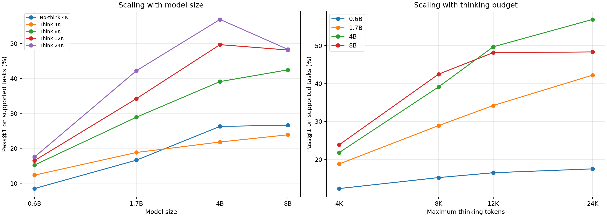

These correlations contain only four model sizes or four thinking budgets. They summarize this matrix and should not be extrapolated as fitted scaling laws.

## 6. Task complexity

### 6.1 Complexity definition

Complexity is defined from benchmark reference solutions rather than generated answers. This choice keeps each task in the same group across every model/configuration and avoids defining difficulty from properties of a failed response.

The primary metric is mean reference-solution `AST_Length`. In this dataset it is associated with:

- LOC: Spearman 0.94;
- Halstead effort: Spearman 0.88;
- maximum nesting depth: Spearman 0.73;
- cyclomatic complexity: Spearman 0.66.

Quartiles are formed once over all 4,229 supported tasks.

| Quartile | Description | Tasks | Minimum AST length | Median | Maximum |
|---|---|---:|---:|---:|---:|
| Q1 | lowest complexity | 1,062 | 14.1 | 57.5 | 79.0 |
| Q2 | low-medium complexity | 1,053 | 79.2 | 101.0 | 126.8 |
| Q3 | medium-high complexity | 1,059 | 126.8 | 160.7 | 207.0 |
| Q4 | highest complexity | 1,055 | 207.0 | 292.4 | 3,212.6 |

### 6.2 Correctness by complexity quartile

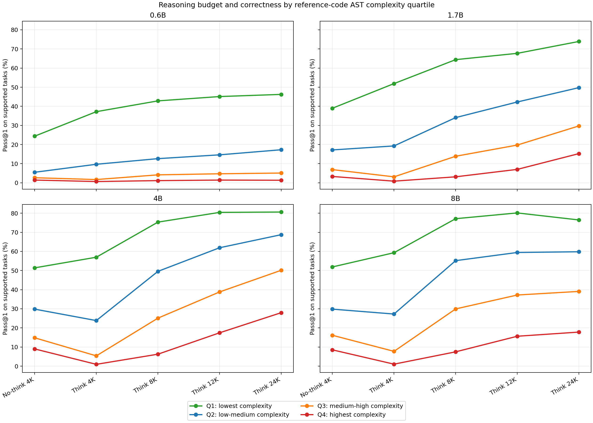

#### Qwen3-0.6B

| Quartile | No-think 4K | Think 4K | Think 8K | Think 12K | Think 24K |
|---|---:|---:|---:|---:|---:|
| Q1 | 24.4% | 37.2% | 42.8% | 45.1% | 46.2% |
| Q2 | 5.5% | 9.7% | 12.6% | 14.6% | 17.3% |
| Q3 | 2.6% | 1.7% | 4.2% | 4.7% | 5.1% |
| Q4 | 1.4% | 0.7% | 1.1% | 1.4% | 1.3% |

#### Qwen3-1.7B

| Quartile | No-think 4K | Think 4K | Think 8K | Think 12K | Think 24K |
|---|---:|---:|---:|---:|---:|
| Q1 | 39.0% | 51.9% | 64.4% | 67.7% | 73.9% |
| Q2 | 17.2% | 19.3% | 34.1% | 42.3% | 49.8% |
| Q3 | 6.9% | 3.1% | 13.9% | 19.7% | 29.7% |
| Q4 | 3.3% | 0.9% | 3.1% | 7.0% | 15.3% |

#### Qwen3-4B

| Quartile | No-think 4K | Think 4K | Think 8K | Think 12K | Think 24K |
|---|---:|---:|---:|---:|---:|
| Q1 | 51.4% | 57.0% | 75.3% | 80.4% | 80.6% |
| Q2 | 29.8% | 23.8% | 49.6% | 61.9% | 68.8% |
| Q3 | 14.8% | 5.4% | 25.1% | 38.8% | 50.1% |
| Q4 | 9.0% | 0.9% | 6.3% | 17.4% | 28.0% |

#### Qwen3-8B

| Quartile | No-think 4K | Think 4K | Think 8K | Think 12K | Think 24K |
|---|---:|---:|---:|---:|---:|
| Q1 | 51.9% | 59.3% | 77.1% | 80.1% | 76.5% |
| Q2 | 29.8% | 27.3% | 55.2% | 59.4% | 59.8% |
| Q3 | 16.1% | 7.7% | 29.9% | 37.2% | 39.1% |
| Q4 | 8.5% | 1.0% | 7.5% | 15.6% | 17.8% |

The complexity gap remains large at every model size and budget. More inference compute helps most when tasks are hard enough to need reasoning but still within the model's capabilities. For 0.6B/Q4, additional budget cannot overcome the capacity limit. For 4B, Q2–Q4 continue to benefit substantially through 24K.

### 6.3 Complexity–correctness association

At the individual-task level, `AST_Length` has a negative Spearman association with acceptance in every model/configuration cell. The range is **-0.543 to -0.313**. This is a robust descriptive pattern, but it does not imply that AST size itself causes failures; AST size is a proxy for several correlated aspects of implementation difficulty.

### 6.4 Cyclomatic-complexity sensitivity check

The Think 24K minus Think 4K gains after redefining quartiles using cyclomatic complexity are:

| Model | Q1 | Q2 | Q3 | Q4 |
|---|---:|---:|---:|---:|
| 0.6B | +7.2 pp | +9.0 pp | +2.9 pp | +1.7 pp |
| 1.7B | +21.5 pp | +27.7 pp | +27.2 pp | +17.5 pp |
| 4B | +27.0 pp | +38.3 pp | +44.0 pp | +31.8 pp |
| 8B | +20.4 pp | +28.3 pp | +29.2 pp | +20.4 pp |

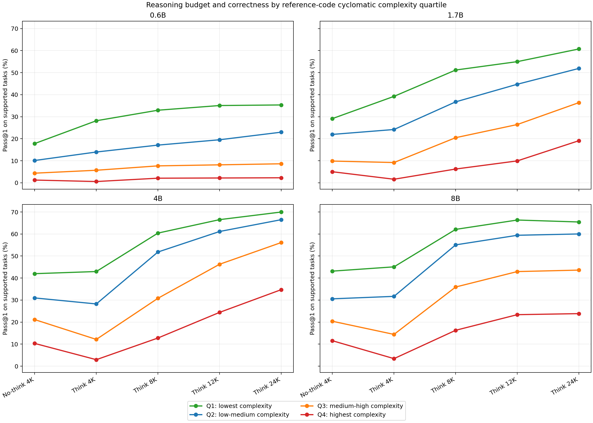

The qualitative conclusion survives this alternate grouping: budget helps most in the middle and high-but-not-impossible regimes.

## 7. Fixed inference configuration: marginal model-capacity gains

### 7.1 Definition of the baseline

For each heatmap cell, the baseline is the smaller model on the left side of the column label. Inference configuration, complexity quartile, and task set are held fixed.

```text
marginal capacity gain = pass@1(larger model) - pass@1(smaller model)
```

For example, Think 8K/Q1 gives:

- 0.6B→1.7B: 64.4% − 42.8% = **+21.6 pp**;
- 1.7B→4B: 75.3% − 64.4% = **+10.9 pp**;
- 4B→8B: 77.1% − 75.3% = **+1.8 pp**.

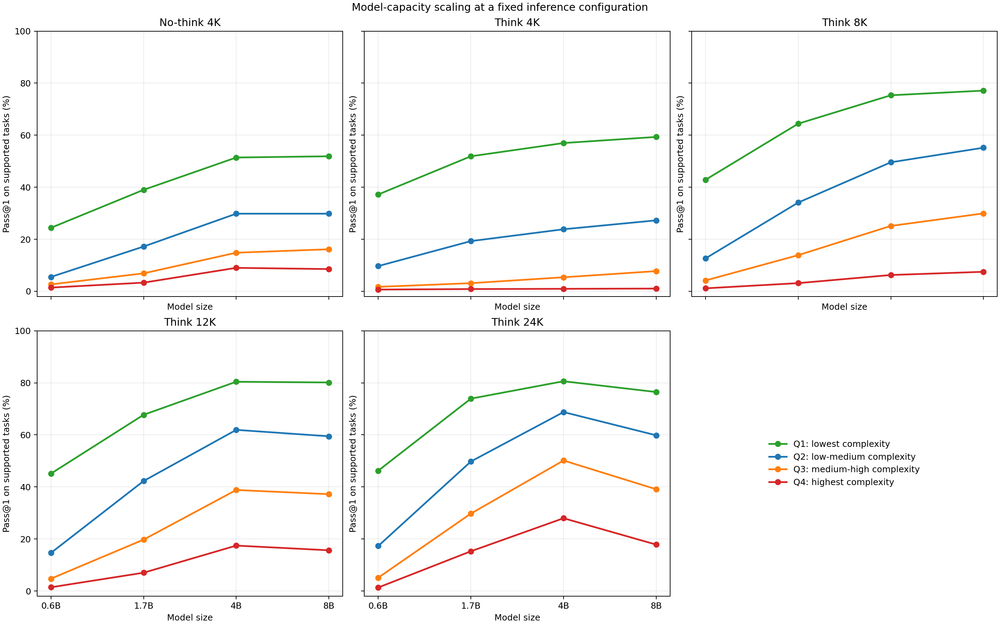

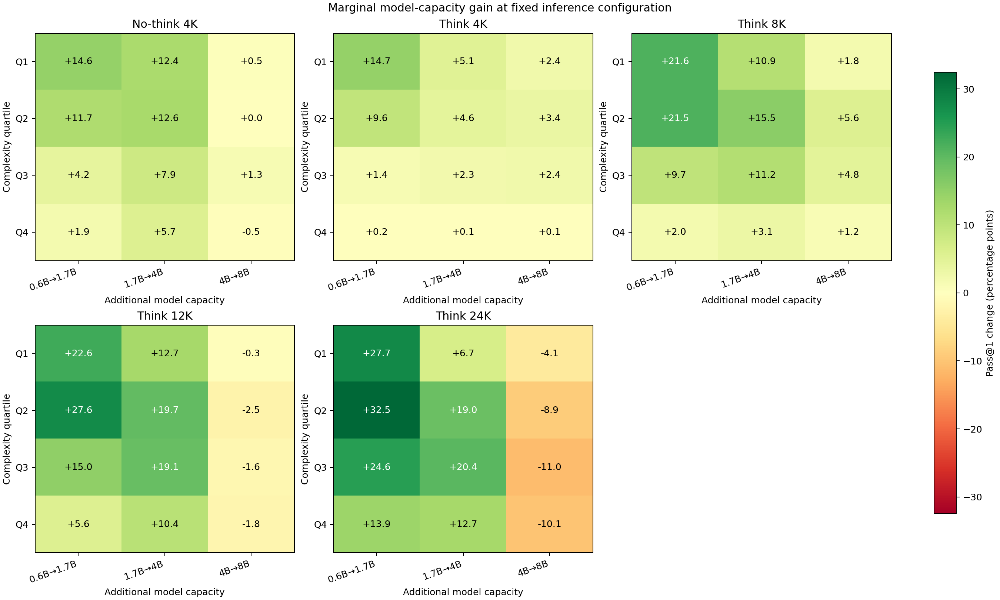

### 7.2 Exact marginal capacity values

| Configuration | Complexity | 0.6B→1.7B | 1.7B→4B | 4B→8B |
|---|---|---:|---:|---:|
| No-think 4K | Q1 | +14.6 | +12.4 | +0.5 |
| No-think 4K | Q2 | +11.7 | +12.6 | +0.0 |
| No-think 4K | Q3 | +4.2 | +7.9 | +1.3 |
| No-think 4K | Q4 | +1.9 | +5.7 | -0.5 |
| Think 4K | Q1 | +14.7 | +5.1 | +2.4 |
| Think 4K | Q2 | +9.6 | +4.6 | +3.4 |
| Think 4K | Q3 | +1.4 | +2.3 | +2.4 |
| Think 4K | Q4 | +0.2 | +0.1 | +0.1 |
| Think 8K | Q1 | +21.6 | +10.9 | +1.8 |
| Think 8K | Q2 | +21.5 | +15.5 | +5.6 |
| Think 8K | Q3 | +9.7 | +11.2 | +4.8 |
| Think 8K | Q4 | +2.0 | +3.1 | +1.2 |
| Think 12K | Q1 | +22.6 | +12.7 | -0.3 |
| Think 12K | Q2 | +27.6 | +19.7 | -2.5 |
| Think 12K | Q3 | +15.0 | +19.1 | -1.6 |
| Think 12K | Q4 | +5.6 | +10.4 | -1.8 |
| Think 24K | Q1 | +27.7 | +6.7 | -4.1 |
| Think 24K | Q2 | +32.5 | +19.0 | -8.9 |
| Think 24K | Q3 | +24.6 | +20.4 | -11.0 |
| Think 24K | Q4 | +13.9 | +12.7 | -10.1 |

The capacity result is consistent across the table:

- 0.6B→1.7B and 1.7B→4B supply most of the useful capacity scaling.
- 4B→8B is positive but small through Think 8K.
- At Think 12K, 4B→8B is negative in every quartile.
- At Think 24K, the 4B→8B regression ranges from -4.1 to -11.0 points.

These negative values are end-to-end outcomes under the observed serving conditions. They do not prove that an error-free 8B model is intrinsically less capable than 4B; the high-budget 8B cells include large request-failure rates.

## 8. Marginal inference-compute gains

### 8.1 Overall gains before conditioning on complexity

| Model | No-think 4K→Think 4K | Think 4K→Think 12K | Think 12K→Think 24K |
|---|---:|---:|---:|
| 0.6B | +3.83 pp | +4.16 pp | +1.02 pp |
| 1.7B | +2.20 pp | +15.39 pp | +7.99 pp |
| 4B | -4.47 pp | +27.86 pp | +7.21 pp |
| 8B | -2.74 pp | +24.26 pp | +0.19 pp |

Think 4K→Think 12K is the dominant transition for the larger models. Think 12K→Think 24K is still useful for 1.7B and 4B, but almost neutral for 8B in aggregate.

### 8.2 Complexity-conditioned gains

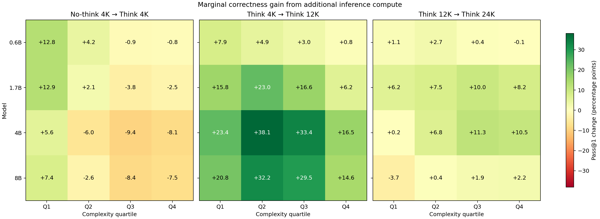

| Model | Complexity | No-think 4K→Think 4K | Think 4K→Think 12K | Think 12K→Think 24K |
|---|---|---:|---:|---:|
| 0.6B | Q1 | +12.8 | +7.9 | +1.1 |
| 0.6B | Q2 | +4.2 | +4.9 | +2.7 |
| 0.6B | Q3 | -0.9 | +3.0 | +0.4 |
| 0.6B | Q4 | -0.8 | +0.8 | -0.1 |
| 1.7B | Q1 | +12.9 | +15.8 | +6.2 |
| 1.7B | Q2 | +2.1 | +23.0 | +7.5 |
| 1.7B | Q3 | -3.8 | +16.6 | +10.0 |
| 1.7B | Q4 | -2.5 | +6.2 | +8.2 |
| 4B | Q1 | +5.6 | +23.4 | +0.2 |
| 4B | Q2 | -6.0 | +38.1 | +6.8 |
| 4B | Q3 | -9.4 | +33.4 | +11.3 |
| 4B | Q4 | -8.1 | +16.5 | +10.5 |
| 8B | Q1 | +7.4 | +20.8 | -3.7 |
| 8B | Q2 | -2.6 | +32.2 | +0.4 |
| 8B | Q3 | -8.4 | +29.5 | +1.9 |
| 8B | Q4 | -7.5 | +14.6 | +2.2 |

### 8.3 Where compute stops paying off

#### 0.6B

- Think 4K helps Q1/Q2 but hurts Q3/Q4 slightly.
- Think 4K→12K provides only +0.8 to +7.9 points depending on complexity.
- Think 12K→24K is at most +2.7 points and is effectively exhausted for Q3/Q4.
- The limiting factor on complex tasks is model capacity rather than token budget.

#### 1.7B

- Think 4K helps Q1/Q2 but hurts Q3/Q4.
- Think 4K→12K is valuable across all quartiles.
- Think 12K→24K remains valuable, especially Q3/Q4 (+10.0 and +8.2 points).
- This model still benefits from long reasoning on harder tasks.

#### 4B

- Think 4K is worse than no-thinking for Q2–Q4 because the 4K reasoning cap frequently prevents a final answer.
- Think 4K→12K is the strongest transition in the matrix: +23.4, +38.1, +33.4, and +16.5 points from Q1 to Q4.
- Think 12K→24K is nearly exhausted for Q1 (+0.2) but remains useful for Q2–Q4 (+6.8 to +11.3).
- This supports an adaptive policy: 12K is enough for many simple tasks, while harder tasks can justify 24K.

#### 8B

- Think 4K again hurts Q2–Q4.
- Think 4K→12K is very strong, but that gain is observed despite a 26.35% request-error rate at 12K.
- Think 12K→24K is -3.7 for Q1 and only +0.4 to +2.2 for Q2–Q4.
- Under the current serving setup, additional 8B budget beyond 12K does not pay off reliably.

## 9. Capacity, compute, and complexity together

The experiment does not support a one-dimensional rule such as “always choose the largest model” or “always allocate the largest budget.” The observed frontier is conditional:

| Goal/regime | Best-supported interpretation from this run |
|---|---|
| Lowest-budget serving | No-think 4K avoids unfinished reasoning and reaches 26.29–26.63% at 4B/8B. |
| Moderate thinking budget | Think 8K restores monotonic model scaling and gives 42.47% at 8B. |
| Maximum observed accuracy | 4B / Think 24K gives 56.89%. |
| Simple Q1 tasks | 4B / Think 12K already reaches 80.4%; 24K adds only +0.2 pp. |
| Q2–Q4 tasks on 4B | Think 24K adds +6.8, +11.3, and +10.5 pp over Think 12K. |
| Very complex Q4 tasks on 0.6B | No budget produces more than 1.4%; capacity is the bottleneck. |
| High-budget 8B serving | Request reliability dominates; 12K→24K adds only +0.19 pp overall. |

One practical interpretation is to route by estimated task complexity:

- use a shorter/no-thinking path for straightforward tasks when latency or serving cost matters;
- use 4B/12K for strong simple-task accuracy without the small Q1 return of 24K;
- reserve 4B/24K for medium/high-complexity tasks where it still produces material gains;
- avoid treating 8B/24K as the default until the timeout mechanism has been fixed and the failed requests rerun.

This routing proposal is motivated by observed correctness, not by measured latency or dollar cost. A deployment decision still requires real serving-time and throughput measurements.

## 10. Threats to validity and interpretation limits

### 10.1 Judge limitations

- Output matching is exact after stripping only leading/trailing whitespace. It does not provide token-wise whitespace equivalence, floating-point tolerance, or problem-specific special judges.
- Each testcase has a two-second timeout, so slow but otherwise correct implementations can fail.
- Evaluation stops at the first failed testcase.
- The 98 unsupported APPS tasks use non-string/function-call-style test cases and require a separate evaluator.
- The results are harness-defined correctness rates, not official APPS or LCB leaderboard scores.

### 10.2 Sampling limitations

- There is one generated answer per task/configuration, so this is pass@1 rather than pass@k.
- There are no repeated random seeds, making it impossible to separate sampling variation from configuration effects.
- Aggregate correlations use only four model sizes or four thinking budgets.

### 10.3 Serving confounding

- Request failures occur primarily in high-budget 4B/8B cells and are not random across the experiment.
- The artifacts expose `ReadTimeout` but do not prove whether the root cause is server compute time, client timeout configuration, queueing, load, or another transport issue.
- Comparisons involving 8B at 12K/24K measure the complete system outcome, not isolated model capability.
- Token means exclude failed requests because those rows contain no token usage.

### 10.4 Complexity limitations

- Reference-code complexity is a proxy for task complexity and depends on implementation style and the available reference solutions.
- `AST_Length` measures structural size more directly than mathematical insight or algorithmic novelty.
- Quartile boundaries are dataset-relative; Q4 means the most structurally complex quarter of this supported task set.
- The cyclomatic-complexity sensitivity analysis supports the broad pattern but does not eliminate all proxy bias.

### 10.5 Scope limitations

- Only APPS and LCB are included in this controlled analysis, even though some run directories also contain HumanEval or MBPP artifacts.
- APPS contributes most tasks, so combined results are APPS-weighted.
- No serving latency, GPU memory, throughput, concurrency, or energy metrics were captured.

## 11. Recommended next experiments

### 11.1 Repair the high-budget serving confound

Rerun only the raw `ReadTimeout` rows with explicit request timing and server logs. Record queue delay, time-to-first-token, total generation time, and the configured client/server timeout. This will distinguish intrinsic generation cost from serving instability.

### 11.2 Add a real vLLM concurrency benchmark

Sweep controlled concurrency levels, for example 1, 2, 4, 8, 16, and 32, while recording:

- completed requests per second;
- p50/p95/p99 latency;
- time to first token;
- inter-token latency;
- timeout/error rate;
- GPU memory and utilization;
- total generated tokens per second.

Keep model, prompt set, and output cap fixed within each sweep. This would turn the current reliability study into a full serving project.

### 11.3 Use adaptive budget routing

Train or define a lightweight pre-generation complexity predictor, then test policies such as:

- Q1 → 4B/12K;
- Q2–Q4 → 4B/24K;
- low-latency mode → 4B/no-think 4K or 8B/no-think 4K.

Evaluate accuracy, actual latency, and token consumption together rather than optimizing pass@1 alone.

### 11.4 Complete judge coverage

Add a sandboxed function-call evaluator for the 98 unsupported APPS tasks, whitespace-aware and floating-point-aware comparison where required, and problem-specific checkers for special-judge tasks.

### 11.5 Add repeated generations

Run multiple seeds per cell to estimate variance, pass@k, and confidence intervals for paired configuration differences. This is essential before calling any relationship a general scaling law.

## 12. Reproducibility

From the `Compression_Law` directory, the existing analysis can be regenerated with:

```bash
python3 analysis/analyze_scaling.py
python3 analysis/analyze_correctness.py
python3 analysis/analyze_complexity_budget.py
```

The correctness harness is run separately because it executes untrusted generated programs:

```bash
python3 test_harness/harness.py \
  --workers 4 \
  --max-in-flight 8 \
  --timeout 2 \
  --output analysis/outputs/correctness_results.csv \
  --overwrite
```

The judge interpreter is `test_harness/.venv/bin/python`.

## 13. Artifact index

### Source analyses

- `analysis/outputs/report.md`: generation length, completion, and request reliability.
- `analysis/outputs/correctness_report.md`: pass@1, dataset breakdowns, and failure composition.
- `analysis/outputs/complexity_correctness_report.md`: complexity-conditioned correctness, capacity gains, and inference-compute gains.

### Core exact-value tables

- `analysis/outputs/summary.csv`
- `analysis/outputs/correctness_summary.csv`
- `analysis/outputs/correctness_status_counts.csv`
- `analysis/outputs/correctness_pass_rate_pct_matrix.csv`
- `analysis/outputs/complexity_budget_correctness.csv`
- `analysis/outputs/complexity_model_capacity_trends.csv`
- `analysis/outputs/complexity_inference_compute_marginal_gains.csv`
- `analysis/outputs/complexity_correctness_correlations.csv`

### Core figures

- `mean_completion_tokens_heatmap.png`
- `error_rate_heatmap.png`
- `scaling_relationships.png`
- `correctness_heatmaps.png`
- `correctness_status_breakdown.png`
- `correctness_scaling.png`
- `complexity_budget_correctness.png`
- `complexity_budget_gain_heatmap.png`
- `complexity_model_capacity_fixed_budget.png`
- `complexity_model_capacity_marginal_gains.png`
- `complexity_inference_compute_marginal_gains.png`
- `complexity_budget_correctness_cyclomatic.png`

## 14. Final conclusion

The experiment shows that inference-time reasoning can substantially improve code-generation correctness, but the gain depends jointly on model capacity, task complexity, output budget, and serving reliability. Small models saturate on hard tasks even with long budgets. Larger models benefit strongly when enough reasoning space is available, but a short thinking cap can be worse than no thinking at all. At the high end, serving failures can reverse the expected capacity ordering: 8B loses to 4B at 12K and 24K despite strong conditional correctness among the programs that actually reach the judge.

The clearest operational result is therefore not a compression or scaling “law.” It is a measured frontier: **4B/12K is already sufficient for many simple tasks; 4B/24K is the best observed accuracy configuration and remains valuable for complex tasks; 8B/high-budget inference requires reliability work before its model-capacity benefit can be evaluated fairly.**
