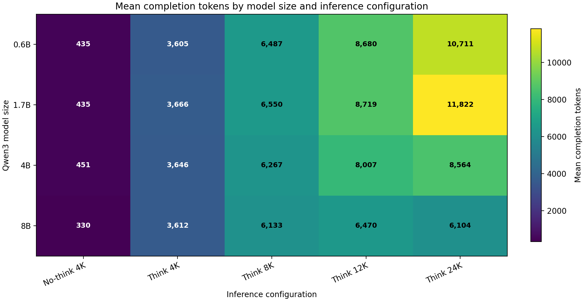
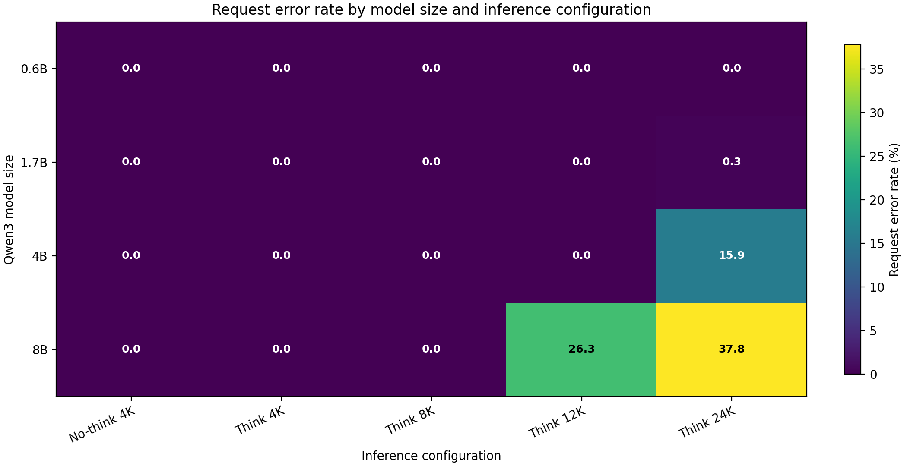
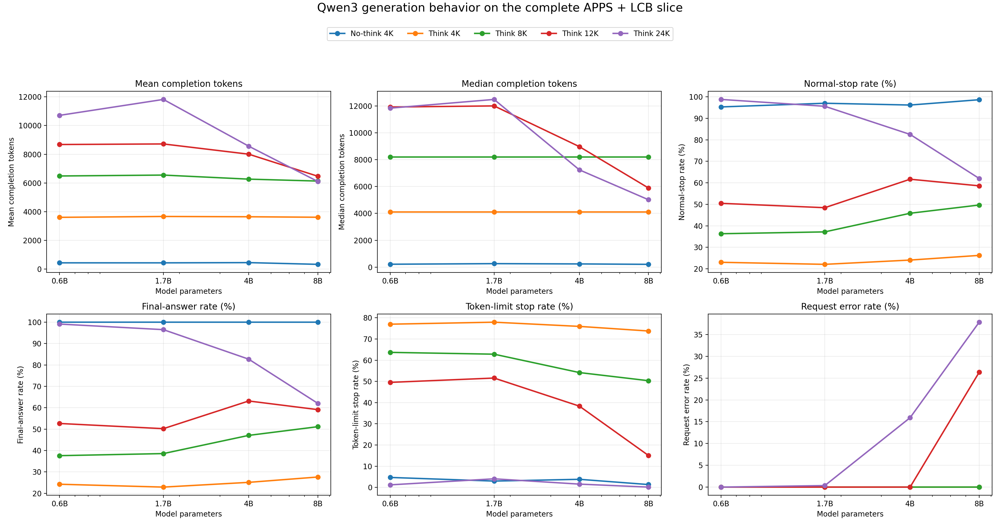

# Qwen3 scaling analysis

Source run: `/data1/sandesh/arka/Compression_Law/generation/runs/vllm/scaling_law_001`

Controlled datasets: APPS, LCB.
Every matrix cell contains the same 4,327 tasks; the analysis covers 86,540 generations across 4 models and 5 configurations.

The tables describe generation behavior, not program correctness. No pass/fail evaluation is present in these generation files.

## Mean completion tokens

| Model | No-think 4K | Think 4K | Think 8K | Think 12K | Think 24K |
|---|---:|---:|---:|---:|---:|
| 0.6B | 435.5 | 3,605.3 | 6,487.0 | 8,679.6 | 10,710.9 |
| 1.7B | 434.7 | 3,665.9 | 6,550.1 | 8,719.2 | 11,821.7 |
| 4B | 450.6 | 3,645.8 | 6,267.1 | 8,006.5 | 8,564.4 |
| 8B | 330.4 | 3,611.7 | 6,133.1 | 6,469.5 | 6,104.4 |

Means and medians use rows containing token usage. Request failures have no token usage and are excluded, so inspect the error-rate table before interpreting apparent length reductions.

## Median completion tokens

| Model | No-think 4K | Think 4K | Think 8K | Think 12K | Think 24K |
|---|---:|---:|---:|---:|---:|
| 0.6B | 215.0 | 4,096.0 | 8,192.0 | 11,916.0 | 11,834.0 |
| 1.7B | 259.0 | 4,096.0 | 8,192.0 | 12,000.0 | 12,483.0 |
| 4B | 238.0 | 4,096.0 | 8,192.0 | 8,968.0 | 7,239.5 |
| 8B | 207.0 | 4,096.0 | 8,192.0 | 5,889.0 | 5,015.0 |

## Normal-stop rate

| Model | No-think 4K | Think 4K | Think 8K | Think 12K | Think 24K |
|---|---:|---:|---:|---:|---:|
| 0.6B | 95.29 | 23.02 | 36.31 | 50.45 | 98.78 |
| 1.7B | 97.00 | 22.07 | 37.16 | 48.42 | 95.59 |
| 4B | 96.16 | 24.06 | 45.83 | 61.66 | 82.51 |
| 8B | 98.64 | 26.23 | 49.66 | 58.59 | 62.01 |

Values are percentages. A normal stop has `finish_reason == "stop"`.

## Final-answer rate

| Model | No-think 4K | Think 4K | Think 8K | Think 12K | Think 24K |
|---|---:|---:|---:|---:|---:|
| 0.6B | 100.00 | 24.24 | 37.60 | 52.65 | 99.12 |
| 1.7B | 100.00 | 22.90 | 38.57 | 50.22 | 96.51 |
| 4B | 100.00 | 25.12 | 47.08 | 63.16 | 82.71 |
| 8B | 100.00 | 27.62 | 51.14 | 59.12 | 62.05 |

For thinking configurations, a final answer requires a closed `</think>` block followed by non-empty text. For the no-thinking baseline, it means a non-empty response.

## Request error rate

| Model | No-think 4K | Think 4K | Think 8K | Think 12K | Think 24K |
|---|---:|---:|---:|---:|---:|
| 0.6B | 0.00 | 0.00 | 0.00 | 0.00 | 0.00 |
| 1.7B | 0.00 | 0.00 | 0.00 | 0.00 | 0.35 |
| 4B | 0.00 | 0.00 | 0.00 | 0.00 | 15.92 |
| 8B | 0.00 | 0.00 | 0.00 | 26.35 | 37.83 |

Values are percentages. Errors in this run are HTTP-client failures recorded by the generator, principally `ReadTimeout`; they must not be interpreted as short successful generations.

## Descriptive correlations

Pearson correlations are descriptive checks based on only four model sizes or four thinking budgets. They should not be treated as fitted scaling laws. A series is marked `confounded` when any included cell has more than 1% request errors.

### Model size

Correlation against log10(model parameters):

| Configuration | Mean tokens r | Median tokens r | Normal-stop r | Final-answer r | Max error rate |
|---|---:|---:|---:|---:|---:|
| No-think 4K | -0.639 | -0.162 | +0.819 | n/a | 0.00% |
| Think 4K | +0.083 | n/a | +0.791 | +0.748 | 0.00% |
| Think 8K | -0.866 | n/a | +0.943 | +0.946 | 0.00% |
| Think 12K | confounded | confounded | confounded | confounded | 26.35% |
| Think 24K | confounded | confounded | confounded | confounded | 37.83% |

### Thinking budget

Correlation against log2(maximum thinking tokens), excluding the no-thinking baseline:

| Model | Mean tokens r | Median tokens r | Normal-stop r | Final-answer r | Max error rate |
|---|---:|---:|---:|---:|---:|
| 0.6B | +0.993 | +0.919 | +0.952 | +0.956 | 0.00% |
| 1.7B | +0.999 | +0.942 | +0.955 | +0.959 | 0.35% |
| 4B | confounded | confounded | confounded | confounded | 15.92% |
| 8B | confounded | confounded | confounded | confounded | 37.83% |

## Files

- `summary.csv`: combined and per-dataset statistics.
- `*_matrix.csv`: the exact values used in the tables and heatmap.
- `model_size_correlations.csv`: correlations across model sizes.
- `thinking_budget_correlations.csv`: correlations across thinking budgets.
